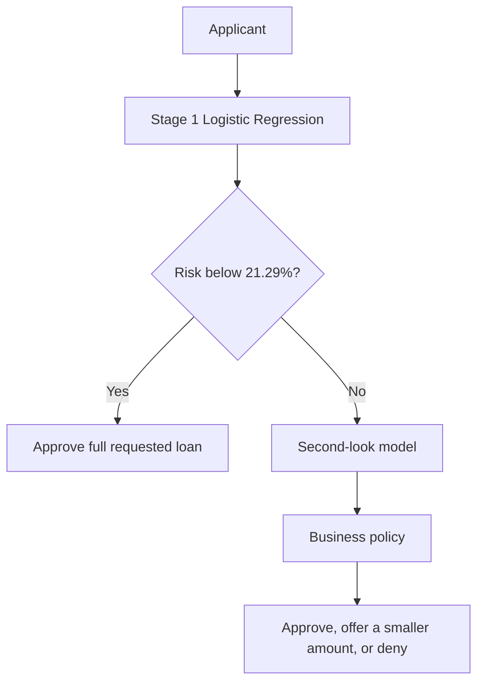

# Logistic Regression Business Summary

## Business Purpose

The Logistic Regression model is the first step in the lending decision process. It estimates each
applicant's chance of default. Applicants below the Stage 1 risk threshold receive an immediate full-loan
approval. Applicants above the threshold are sent to the second-look model for another review. A referral
is not a final denial.

This model is also the team's baseline. Random Forest and LightGBM need to show a clear improvement over
it before either model is used for the second-look stage.

## Results at a Glance

| Business measure | Holdout result |
| --- | ---: |
| Applicants reviewed | 174,128 |
| Overall ROC-AUC | 0.759 |
| Stage 1 risk threshold | 21.29% |
| Immediate full-loan approval rate | 71.0% |
| Referred to second look | 29.0% |
| Default rate among immediate approvals | 10.1% |
| Normalized profit per applicant | 0.352 |
| Stage 1 inclusion gap | 28.7% |

The model's overall ROC-AUC of 0.759 shows useful risk ranking. Performance is
stronger for established applicants at 0.785 than for thin-file applicants
at 0.709. This difference is the main reason the project needs a second-look stage.

## Profitability View

The current profit calculation uses normalized comparison units:

- `+1` when an immediately approved applicant repays.
- `-4` when an immediately approved applicant defaults.
- `0` when an applicant is referred to Stage 2 because the final second-look decision is not available yet.

Under those assumptions, the break-even approved-group default rate is 20%. For every five approved
applicants, one default offsets the value created by four repayers. The 20% figure is an economic
reference point, while Rachel's 10% approved-pool ceiling is the stricter operating rule used by the
current Stage 1 policy.

| Holdout policy | Immediate approval | Approved default rate | Normalized total profit | Profit per applicant | Inclusion gap |
| --- | ---: | ---: | ---: | ---: | ---: |
| Conservative 15% threshold | 55.8% | 7.9% | 59,001 | 0.3388 | 44.9% |
| 20% risk reference | 63.4% | 8.9% | 61,234 | 0.3517 | 39.2% |
| Active 10% approved-pool policy | 71.0% | 10.1% | 61,257 | 0.3518 | 28.7% |
| Maximum-profit candidate | 72.5% | 10.3% | 61,278 | 0.3519 | 26.3% |

The maximum-profit candidate produced only 21 more normalized profit units than the active policy across
174,128 applicants. It also approved more applicants immediately and had a slightly
higher approved-group default rate. The profit gain is very small, so the active policy gives up almost no
modeled profit while staying closer to the team's 10% validation limit and sending more borderline
applicants to Stage 2.

This is not a dollar-profit forecast. It does not yet include interest revenue, loan size, cost of
capital, loss given default, operational review cost, partial-loan economics, or the value recovered by
Stage 2. The table is useful for comparing policies consistently, but final financial impact requires the
team's agreed business values.

## What the Threshold Means

The active policy uses Rachel's 10% approved-pool default ceiling. The 10% rule applies to the average
observed default rate across everyone approved on policy-validation data. It does not mean that every
approved applicant has exactly 10% predicted risk.

That policy produced a 21.29% individual risk-score threshold. On the untouched holdout
period, it approved 71.0% of applicants immediately and referred
29.0% for a second look. The approved group had a
10.1% observed default rate. The small difference from the 10%
validation ceiling is normal movement between time periods.

## Applicant Experience and Credit Risk

At the selected threshold, 32,478 applicants who later
repaid were sent to the second-look model instead of being immediately approved. They still receive
another review. At the same time, 12,490 applicants
who later defaulted received an immediate approval and bypassed Stage 2. These are the more direct
credit-risk errors.

Thin-file repayers were referred at a 43.0% rate, compared with
14.3% for established repayers. The Stage 1 inclusion gap is
28.7%. The second-look model needs to recover qualified thin-file
applicants without increasing losses beyond the team's agreed limit.

## How It Fits Into the Final Product

The second-look position will be filled by either Random Forest or LightGBM after both are compared on
the same time periods and business measures. The current data contains a repayment outcome but does not
contain the correct reduced-loan percentage. Any smaller-loan offer must therefore come from the later
business-policy layer.

Stage 2 is also where additional profit can be created. The current calculation assigns zero value to
every referral. If the second-look model identifies referred applicants who will repay, those approvals
can add value that the Stage 1-only table does not count. The final profitability calculation needs to
combine Stage 1 outcomes, Stage 2 outcomes, review costs, default losses, and any reduced-loan offers.

## Current Business Recommendation

1. Keep this Logistic Regression model as the Stage 1 baseline.
2. Keep the 10% approved-pool policy as the current operating point while Stage 2 is being completed.
3. Compare Random Forest and LightGBM on referred applicants, especially qualified thin-file applicants.
4. Select the final two-stage policy using profit, approved-group default rate, inclusion gap, and
   applicant routing outcomes together.
5. Replace normalized profit units with agreed dollar values before presenting a final financial impact.

## Decisions Still Needed

- The acceptable default-rate ceiling for the final product.
- The dollar value of a repaid loan and the cost of a default.
- Which challenger model earns the Stage 2 position.
- The policy for reduced-loan offers after second-look scoring.
- Ongoing monitoring limits for calibration, applicant mix, approval rates, and inclusion gaps.
