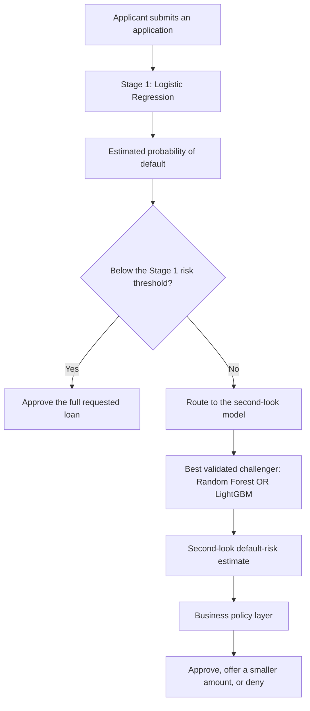

# Logistic Regression Baseline

## What We Built

This model estimates each applicant's probability of default. It is the team's transparent baseline:
Random Forest and LightGBM should be compared against the same rows, time periods, and metrics before one
of them is selected for the second-look stage.

The model uses the completed aggregation, cleaning, and feature-engineering work from Tasks 1-4. The
preprocessing approach from Task 3 is fitted again inside this training workflow using weeks 0-63 only.
That keeps information from later weeks out of the medians, scaling values, and encoded category lists.
Task 5's EDA guides the subgroup reporting and the interpretation of thin-file performance.

## Final Application Pipeline



Random Forest and LightGBM are alternatives for Stage 2; applicants do not pass through both models in
sequence. The current data supplies a default outcome, not a correct loan percentage. A smaller loan
offer therefore belongs in the later business-policy layer rather than being presented as a learned
regression target.

## Data and Time Split

| Split | Weeks | Applicants | Purpose |
| --- | --- | ---: | --- |
| Train | 0-63 | 695,614 | Fit preprocessing and Logistic Regression |
| Calibration | 64-69 | 65,319 | Choose regularization and fit calibration |
| Policy validation | 70-75 | 64,939 | Compare calibration and choose the provisional threshold |
| Holdout | 76-91 | 174,128 | Final labeled evaluation, scored after all choices were fixed |
| Score | Unlabeled test CSV | 200,000 | Produce predictions for the future application/demo pipeline |

- `target = 1` means the applicant defaulted; `target = 0` means the applicant repaid.
- `is_thin_file` is not a model input. It is retained only to compare outcomes for thin-file and
  established applicants.
- `external_coverage` is also excluded because Task 5 showed that its apparent relationship with default
  was caused by the changing mix of thin-file and established applicants, not a useful within-group
  relationship.
- Numeric `-1` values are treated as unknown, replaced with train-period medians, and accompanied by
  missing-value indicators. Numeric features are standardized and categorical features are one-hot
  encoded. The final model matrix contains 138 columns.
- No class weighting is used because reliable probabilities matter more than forcing equal class counts.

## Model Selection

Four L2 regularization strengths were compared on weeks 64-69. The selected value was
`C = 0.01` with LogLoss 0.4051 and
ROC-AUC 0.7649. Smaller `C` values apply stronger regularization.

Raw, sigmoid, and isotonic probabilities were then compared on the later weeks 70-75. The selected
method was **isotonic**. Its policy-validation LogLoss was
0.3978, and its mean predicted
default rate was 18.2%
versus an actual rate of 17.8%.

## Final Holdout Results

| Segment | Applicants | Default rate | Mean predicted PD | ROC-AUC | PR-AUC | LogLoss | Brier |
| --- | ---: | ---: | ---: | ---: | ---: | ---: | ---: |
| All applicants | 174,128 | 17.5% | 18.1% | 0.759 | 0.414 | 0.397 | 0.124 |
| Established | 122,005 | 16.4% | 15.4% | 0.785 | 0.439 | 0.370 | 0.114 |
| Thin-file | 52,123 | 20.0% | 24.3% | 0.709 | 0.363 | 0.463 | 0.148 |

The overall holdout ROC-AUC of 0.759 measures ranking: how often a borrower
who defaulted receives a higher risk score than a borrower who repaid. LogLoss and Brier score judge the
quality of the probabilities themselves, so confident mistakes receive a larger penalty.

Performance is stronger for established applicants (AUC 0.785) than for
thin-file applicants (AUC 0.709). That difference is expected from the EDA:
established applicants have bureau risk and payment-history fields, while thin-file applicants rely more
on education, employment, income, affordability, tax-registry, and prior-application information.

Overall calibration is close, but it is not equally close for both groups. The model predicts an average
default probability of 24.3% for thin-file applicants versus their
actual 20.0% default rate. For established applicants, it predicts
15.4% versus an actual 16.4%.
The final two-stage comparison should therefore examine subgroup calibration, not only the overall score.

## Provisional Stage 1 Policy

The selected probability threshold is **21.0%**. On policy-validation weeks, it sent
65.2% of applicants directly to a full-loan approval, produced an observed default rate of
9.2% among approvals, and had an inclusion gap of
38.3%. A positive inclusion gap means established applicants who
would repay reached an immediate full-loan approval more often than thin-file applicants who would repay.
The applicants not approved at Stage 1 are routed to the second-look model rather than treated as final
denials. Reducing this large routing gap is one of the main jobs of Stage 2.

On the untouched holdout period, that same threshold produced:

| Policy | Immediate full-loan rate | Default rate among approved | Profit per applicant | Stage 1 inclusion gap |
| --- | ---: | ---: | ---: | ---: |
| Selected threshold (21.0%) | 65.7% | 9.3% | 0.351 | 38.1% |
| 20% PD reference | 63.1% | 8.9% | 0.351 | 39.2% |

Profit is reported in normalized units: `+1` for an approved applicant who repays, `-4` for an approved
applicant who defaults, and `0` for an applicant who is not approved at Stage 1. This creates the 20%
break-even reference used in the EDA. These are comparison units, not dollar estimates. The team can
replace them when the final business cost assumptions and Inclusive Profit Score penalty are agreed.

The threshold is provisional because Stage 1 applicants above it will ultimately receive a second look,
not an automatic final denial. The complete two-stage policy should be tuned only after the Random Forest
and LightGBM results are available.

## Strongest Coefficients

Positive coefficients move predictions toward default; negative coefficients move predictions toward
repayment. Numeric coefficients use standardized inputs, while categorical coefficients compare an
encoded category with the model intercept and other categories. Masked category codes are preserved
because the source data does not provide their real-world names.

### Higher Predicted Risk

| Feature | Coefficient | Odds ratio | Interpretation |
| --- | ---: | ---: | --- |
| Education category 2d4a2bc4 | 0.917 | 2.50 | higher predicted default risk |
| Education category 242b264b | 0.478 | 1.61 | higher predicted default risk |
| Risk assessment score | 0.473 | 1.60 | higher predicted default risk |
| Risk assessment score missing | 0.279 | 1.32 | higher predicted default risk |
| Number of unknown values | 0.262 | 1.30 | higher predicted default risk |

### Lower Predicted Risk

| Feature | Coefficient | Odds ratio | Interpretation |
| --- | ---: | ---: | --- |
| Education category f937ecaa | -0.959 | 0.38 | lower predicted default risk |
| Education category 10795bac | -0.369 | 0.69 | lower predicted default risk |
| Credit-file description 5568a5e6 | -0.125 | 0.88 | lower predicted default risk |
| Marital-status category ea6fb4b5 | -0.119 | 0.89 | lower predicted default risk |
| Marital-status category f62a4fc7 | -0.115 | 0.89 | lower predicted default risk |

Coefficients describe the model's fitted associations, not proof that changing a feature would cause a
different repayment outcome. Correlated fields can also divide the same signal across several
coefficients.

## Files Produced

- `models/artifacts/logistic_pipeline.joblib`: preprocessing, Logistic Regression, calibration, and the
  provisional Stage 1 threshold.
- `data/predictions/logistic_score_predictions.csv`: local predictions for the unlabeled scoring set.
- `reports/logistic/model_metrics.csv`: model metrics overall and by applicant segment.
- `reports/logistic/hyperparameter_results.csv`: regularization comparison.
- `reports/logistic/calibration_results.csv`: raw versus calibrated probabilities.
- `reports/logistic/threshold_results.csv`: policy trade-offs across thresholds.
- `reports/logistic/holdout_policy.csv`: selected and 20% reference policies on holdout.
- `reports/logistic/coefficients.csv`: every fitted coefficient and odds ratio.
- `reports/logistic/figures/`: ROC, precision-recall, calibration, score distribution, policy, coefficient,
  and subgroup figures.

## Reproducing the Analysis

From the repository root, after the feature datasets have been generated:

```bash
python models/train_logistic.py
```

The random seed, time boundaries, preprocessing rules, candidate regularization values, calibration
comparison, and policy assumptions are all defined in the script so another teammate can reproduce the
same results.

To reuse the saved model without retraining it:

```bash
python models/predict_logistic.py --input data/features/test_features.csv
```
