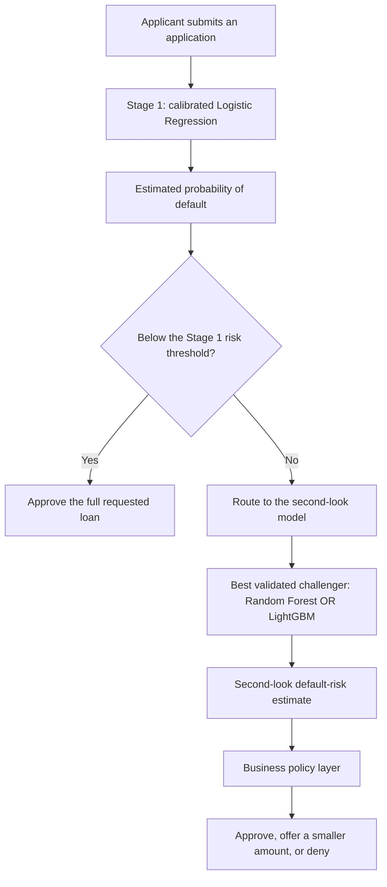

# Integrated Logistic Regression Baseline

## What We Built

This branch keeps Rachel's Logistic Regression workflow as the base and adds probability calibration,
two policy choices, a saved model artifact, frontend-ready routing flags, detailed metrics, routing-error
analysis, plots, and one written results summary.

The model estimates each applicant's probability of default. It is the transparent Stage 1 baseline:
low-risk applicants receive an immediate full-loan approval. Everyone else is referred to the selected
Random Forest or LightGBM second-look model rather than being treated as finally denied.

## Final Application Pipeline



Random Forest and LightGBM are alternatives for Stage 2; applicants do not pass through both models in
sequence. The current data supplies a default outcome, not a correct loan percentage. A smaller loan
offer therefore belongs in the later business-policy layer rather than being presented as a learned
regression target.

## Data and Time Split

| Split | Weeks | Applicants | Purpose |
| --- | --- | ---: | --- |
| Train | 0-63 | 695,614 | Fit preprocessing and Logistic Regression |
| Calibration | 64-69 | 65,319 | Choose regularization and fit calibration |
| Policy validation | 70-75 | 64,939 | Compare calibration and choose the Stage 1 threshold |
| Holdout | 76-91 | 174,128 | Final labeled evaluation, scored after all choices were fixed |
| Score | Unlabeled test CSV | 200,000 | Produce predictions for the future application/demo pipeline |

- `target = 1` means the applicant defaulted; `target = 0` means the applicant repaid.
- `is_thin_file` is not a model input. It is retained only to compare outcomes for thin-file and
  established applicants.
- `external_coverage` is also excluded because Task 5 showed that its apparent relationship with default
  was caused by the changing mix of thin-file and established applicants, not a useful within-group
  relationship.
- Numeric `-1` values are treated as unknown, replaced with train-period medians, and accompanied by
  missing-value indicators. Numeric features are standardized. Categorical features are most-frequent
  imputed and one-hot encoded. The final model matrix contains 138 columns.
- No class weighting is used because reliable probabilities matter more than forcing equal class counts.

Rachel's broad engineered feature set remains intact: income and employment, requested-credit and
affordability ratios, risk-score availability, payment and delinquency history, tax-registry aggregates,
prior-application behavior, external-record counts, and the encoded education, housing, marital-status,
and credit-file categories all remain available to the model. The feature manifest records every input.

## Model Selection

Four L2 regularization strengths were compared on weeks 64-69. The selected value was
`C = 0.01` with LogLoss 0.4051 and
ROC-AUC 0.7649. Smaller `C` values apply stronger regularization.

Raw, sigmoid, and isotonic probabilities were then compared on the later weeks 70-75. The selected
method was **isotonic**. Its policy-validation LogLoss was
0.3979, and its mean predicted
default rate was 18.2%
versus an actual rate of 17.8%.

## Final Holdout Results

| Segment | Applicants | Default rate | Mean predicted PD | ROC-AUC | PR-AUC | LogLoss | Brier |
| --- | ---: | ---: | ---: | ---: | ---: | ---: | ---: |
| All applicants | 174,128 | 17.5% | 18.1% | 0.759 | 0.414 | 0.397 | 0.124 |
| Established | 122,005 | 16.4% | 15.4% | 0.785 | 0.438 | 0.370 | 0.114 |
| Thin-file | 52,123 | 20.0% | 24.3% | 0.709 | 0.362 | 0.463 | 0.148 |

The overall holdout ROC-AUC of 0.759 measures ranking: how often a borrower
who defaulted receives a higher risk score than a borrower who repaid. LogLoss and Brier score judge the
quality of the probabilities themselves, so confident mistakes receive a larger penalty.

Performance is stronger for established applicants (AUC 0.785) than for
thin-file applicants (AUC 0.709). That difference is expected from the EDA:
established applicants have bureau risk and payment-history fields, while thin-file applicants rely more
on education, employment, income, affordability, tax-registry, and prior-application information.

Overall calibration is close, but it is not equally close for both groups. The model predicts an average
default probability of 24.3% for thin-file applicants versus their
actual 20.0% default rate. For established applicants, it predicts
15.4% versus an actual 16.4%.
The final two-stage comparison needs to examine subgroup calibration, not only the overall score.

## Stage 1 Routing Policy

The active policy is **default ceiling** with a probability threshold of
**21.29%**. On policy-validation weeks, it sent
70.7% of applicants directly to a full-loan approval, produced an observed default rate of
10.0% among approvals, and had an inclusion gap of
29.4%. A positive inclusion gap means established applicants who
would repay reached an immediate full-loan approval more often than thin-file applicants who would repay.
The applicants not approved at Stage 1 are routed to the second-look model rather than treated as final
denials. Reducing this routing gap is one of the main jobs of Stage 2.

For Rachel's default-ceiling policy, `10%` means the maximum observed default rate for
the **entire approved pool** on policy-validation data. It is not the individual applicant threshold.
The largest approved pool satisfying that rule produced a 21.29% risk-score
threshold. The alternate normalized-profit policy selected 21.50%.

| Policy-validation threshold | Immediate full-loan rate | Default rate among approved | Profit per applicant | Stage 1 inclusion gap |
| --- | ---: | ---: | ---: | ---: |
| Lower Stage 1 reference (15%) | 55.5% | 7.7% | 0.341 | 45.1% |
| Break-even reference (20%) | 63.0% | 8.8% | 0.353 | 39.3% |
| Default-ceiling candidate (21.29%) | 70.7% | 10.0% | 0.354 | 29.4% |
| Profit candidate (21.50%) | 72.1% | 10.2% | 0.353 | 27.1% |
| Selected baseline (21.29%) | 70.7% | 10.0% | 0.354 | 29.4% |
| Upper Stage 1 reference (22%) | 72.1% | 10.2% | 0.353 | 27.1% |

On the untouched holdout period, that same threshold produced:

| Policy | Immediate full-loan rate | Default rate among approved | Profit per applicant | Stage 1 inclusion gap |
| --- | ---: | ---: | ---: | ---: |
| Lower Stage 1 reference (15%) | 55.8% | 7.9% | 0.339 | 44.9% |
| 20% PD reference | 63.4% | 8.9% | 0.352 | 39.2% |
| Default-ceiling candidate (21.29%) | 71.0% | 10.1% | 0.352 | 28.7% |
| Profit candidate (21.50%) | 72.5% | 10.3% | 0.352 | 26.3% |
| Selected threshold (21.3%) | 71.0% | 10.1% | 0.352 | 28.7% |
| Upper Stage 1 reference (22%) | 72.5% | 10.3% | 0.352 | 26.3% |

Profit is reported in normalized units: `+1` for an approved applicant who repays, `-4` for an approved
applicant who defaults, and `0` for an applicant who is not approved at Stage 1. This creates the 20%
break-even reference used in the EDA. These are comparison units, not dollar estimates. The team can
replace them when the final business cost assumptions and Inclusive Profit Score penalty are agreed.

### How Stage 2 Should Change the Threshold Decision

The threshold can still change because Stage 1 applicants above it will ultimately receive a second look,
not an automatic final denial. Lowering the Stage 1 threshold is not automatically fairer: at 15%, the
standalone model approves fewer applicants, earns less profit, and produces a larger Stage 1 inclusion
gap. Its potential advantage is that it reserves more borderline applications for a stronger Stage 2
model. Raising the threshold to 22% does the opposite: it approves more applicants immediately and
reduces the standalone routing gap, but it also allows more borderline decisions to bypass Stage 2.

Once Random Forest and LightGBM predictions are available, the team should start by comparing Stage 1
thresholds from 15% through 22%. The final choice should maximize the complete two-stage policy's profit
or Inclusive Profit Score while satisfying the agreed default-rate ceiling and minimizing the final
inclusion gap. If the selected challenger is clearly stronger and well calibrated, a threshold toward
the lower end may be useful because Stage 2 receives more cases. If Stage 2 adds little improvement, a
threshold near the current 21%-22% range may be more useful. These choices must be made on validation
data; the holdout results above are reported only as a final stability check.

## False Positives and False Negatives

For routing analysis, a second-look referral is the positive prediction. A **false positive** is a
repaying applicant who was referred instead of immediately approved. A **false negative** is a defaulting
applicant who received an immediate Stage 1 approval and bypassed Stage 2.

| Segment | Repaid approved | Repaid referred | Default approved | Default referred | Repayer referral rate | Default approval rate |
| --- | ---: | ---: | ---: | ---: | ---: | ---: |
| All applicants | 111,217 | 32,478 | 12,490 | 17,943 | 22.6% | 41.0% |
| Established | 87,449 | 14,565 | 9,606 | 10,385 | 14.3% | 48.1% |
| Thin-file | 23,768 | 17,913 | 2,884 | 7,558 | 43.0% | 27.6% |

False positives cost convenience but still receive a second review. False negatives are the more direct
credit-risk error because they bypass Stage 2. Reporting both by segment keeps those trade-offs visible.

## Strongest Coefficients

Positive coefficients move predictions toward default; negative coefficients move predictions toward
repayment. Numeric coefficients use standardized inputs, while categorical coefficients compare an
encoded category with the model intercept and other categories. Masked category codes are preserved
because the source data does not provide their real-world names.

### Higher Predicted Risk

| Feature | Coefficient | Odds ratio | Interpretation |
| --- | ---: | ---: | --- |
| Education category 2d4a2bc4 | 0.679 | 1.97 | higher predicted default risk |
| Risk assessment score | 0.472 | 1.60 | higher predicted default risk |
| Education category 242b264b | 0.242 | 1.27 | higher predicted default risk |
| Risk assessment score missing | 0.156 | 1.17 | higher predicted default risk |
| Average days past due | 0.095 | 1.10 | higher predicted default risk |

### Lower Predicted Risk

| Feature | Coefficient | Odds ratio | Interpretation |
| --- | ---: | ---: | --- |
| Education category f937ecaa | -1.195 | 0.30 | lower predicted default risk |
| Education category 10795bac | -0.600 | 0.55 | lower predicted default risk |
| Credit-file description MISSING | -0.284 | 0.75 | lower predicted default risk |
| Marital-status category ea6fb4b5 | -0.260 | 0.77 | lower predicted default risk |
| Marital-status category f62a4fc7 | -0.256 | 0.77 | lower predicted default risk |

Coefficients describe the model's fitted associations, not proof that changing a feature would cause a
different repayment outcome. Correlated fields can also divide the same signal across several
coefficients.

## Files Produced

- `models/artifacts/logistic_pipeline.joblib`: preprocessing, Logistic Regression, calibration, and the
  current Stage 1 threshold.
- `models/predict_logistic.py`: reusable scoring entry point for the frontend.
- `data/predictions/logistic_*_predictions.csv`: local scores and routing flags for every split.
- `reports/logistic/BUSINESS_SUMMARY.md`: plain-language results and business decisions.
- `reports/logistic/model_metrics.csv`: model metrics overall and by applicant segment.
- `reports/logistic/feature_manifest.csv`: every retained Rachel-baseline input and its preprocessing.
- `reports/logistic/hyperparameter_results.csv`: regularization comparison.
- `reports/logistic/calibration_results.csv`: raw versus calibrated probabilities.
- `reports/logistic/threshold_results.csv`: policy trade-offs across thresholds.
- `reports/logistic/holdout_policy.csv`: selected and reference policies on holdout.
- `reports/logistic/confusion_metrics.csv`: routing-error counts and rates overall and by segment.
- `reports/logistic/coefficients.csv`: every fitted coefficient and odds ratio.
- `reports/logistic/figures/`: ROC, precision-recall, calibration, score distribution, policy, coefficient,
  subgroup, and routing-error figures.

Training predictions are in-sample and are included for inspection only. A referral-specialized Stage 2
model should use time-forward or out-of-fold Stage 1 predictions instead of treating these training
routes as unbiased labels.

## Reproducing the Analysis

From the repository root, after the feature datasets have been generated:

```bash
python models/logistic_baseline.py
```

The random seed, time boundaries, preprocessing rules, candidate regularization values, calibration
comparison, and policy assumptions are all defined in the script so another teammate can reproduce the
same results.

To reuse the saved model without retraining it:

```bash
python models/predict_logistic.py --input data/features/test_features.csv
```
